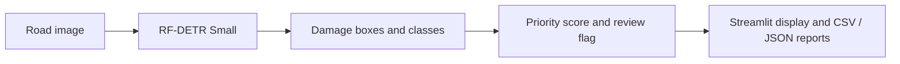

# RoadScan

Road damage detection and maintenance prioritization using RF-DETR Small.

**AIEP Capstone, Track A** · Rama Alzarouk · Amira Alharbi · Shatha Mahrous

RoadScan locates longitudinal cracks, transverse cracks, alligator cracks and potholes. The CPU Streamlit application displays bounding boxes, a rule-based priority score, review flags, and CSV/JSON exports. The trained deployment checkpoint and its validation-selected configuration are included through Git LFS.


## Notebooks

The numbered notebooks in `notebooks/` cover preprocessing, the ResNet18 image-classification baseline, RF-DETR detection and priority evaluation, similarity experiments, the application, and controlled model experiments. They are separate workflows; the application and detector use the Python modules under `src/roadscan/` and do not require running the other notebooks first. Similarity experiments are optional and are not part of the delivered detection workflow.

## System



## Install and run

Use Python 3.11. The original dependency file is preserved; RF-DETR is pinned to 1.11.2. PyTorch and torchvision must be a compatible pair for your platform.

```powershell
git lfs install
git lfs pull
py -3.11 -m venv .venv
.\.venv\Scripts\Activate.ps1
python -m pip install --upgrade pip
python -m pip install -r requirements.txt
python -m pip install -e .
python scripts/verify_artifacts.py
python -m streamlit run notebooks/application/app.py
```

Open the localhost URL printed by Streamlit, upload a new road image, and select **Detect road damage**. The application runs on CPU. Its default resolution is 512 and default confidence is 0.33. Moving the confidence slider changes the operating point and may increase false detections. Uploaded images and generated reports are runtime files excluded from Git.

Command-line prediction using the same saved model and policy:

```powershell
python scripts/predict_image.py --image "C:\path\to\road.jpg" --output runtime/prediction.json
```

## Recorded deployment results

| Dataset | Images | mAP50 | mAP50:95 | Macro precision | Macro recall | Macro F1 |
|---|---:|---:|---:|---:|---:|---:|
| RDD test | 799 | 55.89% | 27.78% | 57.27% | 54.57% | 55.72% |
| Saudi external test | 100 | 49.16% | 25.48% | 42.41% | 54.49% | 46.57% |

These are the saved values in `results/detection_metrics.csv`, not newly generated measurements. The RF checkpoint SHA-256 is `49f92ee3281443fcab6d7b9b388d4b8b996751c2912a8c26800860ced83e62a8`. Historical training-split alignment is not independently verified; see the saved model card and configuration. Do not conflate this checkpoint with the separately trained held-out-country experiment models.

The application screenshot example measured 0.1516 seconds for prediction plus confidence filtering on one image, at a demonstration threshold of 0.05. It excludes loading, image decoding, priority calculation, drawing, report writing and UI rendering. It is not a general CPU benchmark or full application latency.
*Dataset Link:* https://drive.google.com/file/d/1BsQFz1DUczqfnV--y-CxnJOWqaO4wB3m/view?usp=sharing

## Model weights and training checkpoints

Run `git lfs pull` after cloning to download the model files. The supplied weights are kept in separate locations because they serve different purposes:

| File | Purpose |
|---|---|
| `models/deployment/rf_small.pth` | RF-DETR checkpoint used by the Streamlit application. Its validation-selected configuration is tied to this file's SHA-256. |
| `models/training/rf_small_20epoch_backup/last.ckpt` | Full RF-DETR training checkpoint from the supplied backup; its metadata records 20 completed epochs. It includes training state and is separate from the deployment checkpoint above. |
| `models/training/rf_small_20epoch_backup/checkpoint_best_ema.pth` and `checkpoint_best_total.pth` | Best weights saved in that 20-epoch training backup. They are not interchangeable with the deployment checkpoint or its saved thresholds. |
| `models/baselines/resnet18_baseline_weights.pt` | ResNet18 image-level classifier weights. The file records 20 epochs, input size 224, the four class names, and threshold 0.5. This is a weights-only artifact, not a resumable optimizer checkpoint or an object detector. |

To load the ResNet18 weights for inference:

```python
import torch
from torch import nn
from torchvision import models

saved = torch.load(
    "models/baselines/resnet18_baseline_weights.pt",
    map_location="cpu",
    weights_only=True,
)
model = models.resnet18(weights=None)
model.fc = nn.Linear(model.fc.in_features, len(saved["classes"]))
model.load_state_dict(saved["state_dict"])
model.eval()
```

This baseline predicts image-level class presence; it does not produce damage boxes and its classification metrics must not be compared directly with detector mAP.

## Data and evaluation

The curated release contains 8,000 RDD images (6,404 train, 797 validation, 799 test) and 100 Saudi external-test images. Saudi images are excluded from training and threshold selection. Original manifests, checksums, source attribution and data cards are in `data/metadata/`.

- RDD2022: https://figshare.com/articles/dataset/21431547 and https://github.com/sekilab/RoadDamageDetector
- SaudiRD2 v2: https://universe.roboflow.com/manalbitesbytes/saudird-2/dataset/2 (CC BY 4.0, as recorded in the dataset metadata).

The selected subset cannot be reconstructed exactly merely by downloading the upstream sources. Obtain `RoadScan_Dataset.zip` from this repository's `v1.0-data` Release. The maintainer must publish that Release using `docs/PUBLISH_FROM_VSCODE.md`; a Release has not been published by this packaging step.

```powershell
python scripts/download_dataset.py
# Alternatively, import the exact local ZIP supplied with this delivery:
python scripts/download_dataset.py --archive .local_artifacts/RoadScan_Dataset.zip
python scripts/evaluate.py --data data/extracted --output results/evaluation
```

The import script finds the real dataset root regardless of nested folder wrappers and validates all image/label checksums. Evaluation uses the frozen saved thresholds; it does not tune on test images or overwrite original results. CPU evaluation of the full test set can be slow.

For model training and controlled experiments, open `notebooks/06-Roadscan-AllExperiments.ipynb` and read its configuration cell. GPU is needed for training; update the data/checkpoint paths for your environment. Historical notebook cells and saved outputs are preserved.

## Experiments and scope

`docs/EXPERIMENTS.md` explains baseline comparison, resolution, augmentation, held-out-country testing, YOLO26n fine-tuning and SAHI. Supporting original notebooks are under `notebooks/previous_models/`. Their historical splits differ: do not rank detectors using scores drawn from different protocols.

The instructor canceled the E5 duplicate-method experiment and accepted public Saudi data in place of team-captured local images, as confirmed by the team. Legacy similarity modules and encoder assets are retained unchanged for provenance; duplicate detection is not part of the delivered Streamlit workflow and no validated E5 result is claimed.

## Verification

```powershell
python -m unittest discover -s tests -v
python scripts/verify_artifacts.py
```

The unit tests use synthetic fixtures to test software behavior. They are not model accuracy evidence. Packaging checks and any executed tests are recorded in `docs/PACKAGING_VERIFICATION.json`.

## Limitations and future work

Priority is an experimental scoring rule based on damage type, relative box area and count, not an expert-certified civil-engineering urgency or damage-depth estimate. Confidence drives review flags separately. Saudi annotation completeness and scene independence have not been independently certified; successive views may occur. Unseen countries, lighting and camera conditions can reduce detection quality. Human review remains necessary. More independently annotated Saudi scenes and expert priority validation are appropriate next steps.

## Repository map

- `src/roadscan/`: original modular detection, preprocessing, evaluation and priority code.
- `notebooks/application/app.py`: original working Streamlit application.
- `notebooks/`: original notebooks with saved outputs.
- `models/deployment/`: RF deployment checkpoint, configuration and retained legacy encoder.
- `models/training/`: separate RF-DETR 20-epoch backup with the full resume checkpoint and best weights; large files are tracked with Git LFS.
- `models/baselines/`: ResNet18 image-classification baseline weights.
- `results/`: recorded metrics, figures and training metadata.
- `data/metadata/`: exact dataset definition and integrity files.
- `scripts/`: added portable prediction, evaluation, dataset import and verification commands.
- `.local_artifacts/`: ignored local dataset/checkpoints, not included in a normal Git commit.

No technical report or presentation is included, as requested. Third-party data, code and models retain their own terms; see `THIRD_PARTY_CREDITS.md`. No new blanket license is assigned to third-party assets.
